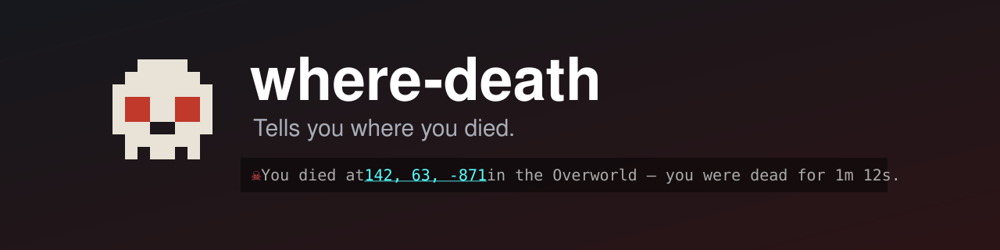

<p align="center">
  
</p>

<p align="center">
  <a href="https://github.com/MysticalWizard/where-death/actions/workflows/build.yml"></a>
  <a href="https://github.com/MysticalWizard/where-death/actions/workflows/compatibility.yml"></a>
  
  
  <a href="LICENSE"></a>
</p>

Tells you where you died. After you respawn you get a chat line like:

```
☠ You died at 142, 63, -871 in the Overworld — you were dead for 1m 12s.
```

Only you see it. It is a system message sent to one player, never chat, so it is invisible to
everyone else on the server.

The coordinates are clickable: clicking them drops `142 63 -871` into your chat box without
sending it, ready to share with whoever is coming to help you get your stuff back.

## Works two ways

- **Installed on a server** — every player gets the message, including players on vanilla clients
  with nothing installed.
- **Installed on your client** — you get the message on any server, including vanilla ones and
  Realms, without the server knowing anything about it.

If both sides have the mod, the client reports and the server stays quiet, so you never see the
message twice. The server detects this from the network channel the client advertises on join.

Deaths are also written to the log the moment they happen, so a server's console keeps a record
even if the player never respawns:

```
[where-death] mystwiz died at 142, 63, -871 in minecraft:overworld
```

## Limits

- The duration is real time, not play time. Dying and logging back in the next day reads
  `you were dead for 19h 04m 12s`.
- If a **server** restarts while you are dead, the death time is lost and the message drops the
  duration, falling back to the location Minecraft itself saves for the recovery compass.
- The **client**-side path only reports deaths it saw happen. Disconnect while dead and reconnect,
  and a client-only install stays quiet — a server install still reports it.

## Building

```
./gradlew build      # jar lands in build/libs
./gradlew test       # logic tests, no game needed
./gradlew runClient  # dev client
./gradlew runServer  # dev server
```

## License

Available under the MIT license.
